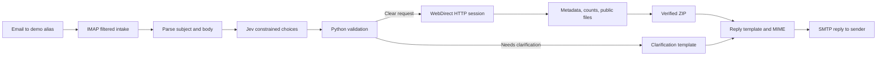

# Loom demo — live email to ZIP in about five minutes

Lead with the working result: a normal email produces a reply with ten documents in a ZIP. The live Gmail worker has received a real external request, sent the reply, and the recipient has confirmed receipt. Reviewers only email the demo address supplied separately with the submission; they do not configure anything.

## Prepare the recording

1. Keep the Mac online with its lid open. The live worker is already running; do not start a second watcher.
2. Open the test email and its received reply in your email client. Hide unrelated messages. Keep the received ZIP ready to open.
3. Open these editor tabs, in order: `uarb_agent/service.py`, `uarb_agent/interpret.py`, `uarb_agent/models.py`, `uarb_agent/uarb.py`, `uarb_agent/delivery.py`, `uarb_agent/mailbox.py`, and `docs/benchmarks.json`.
4. Keep `.env` and Google account/app-password pages off screen. Use `.env.example` when explaining configuration.
5. In a terminal at the repository root, activate the virtual environment and run the checks below. The job listing remains usable while the worker runs.

```sh
source .venv/bin/activate
python -m pytest -q
uarb-agent jobs
```

For a fresh recorded demonstration, send a new email from your normal email account to the configured demo alias. Use an ordinary subject such as **Regulatory documents** and this body:

> Please send me the Other Documents for matter M12205.

While it runs, begin explaining the code. Return to the received reply and open its ZIP when it arrives. If using the existing successful email instead, explicitly call it a previously completed run.

## Recording script

| Time | Show | Suggested narration |
|---|---|---|
| 0:00–0:35 | Send the test email, or show the previously completed request and reply | “This Python agent turns an email request into a ZIP of public regulatory documents. A reviewer sends a matter number and document category to the demo address and gets the documents back by email. There is no setup for the person making the request.” |
| 0:35–1:00 | Reply metadata, five category counts, and ten files inside the ZIP | “Here is the result for M12205, Other Documents: the matter information, the category counts reported by the portal, and ten public files in one ZIP. This is the actual reply received in an external inbox. Category counts and the number downloaded are shown separately.” |
| 1:00–1:35 | `service.py`: `Agent.process`; then `interpret.py`: `parse_email`, `_build_choice_questions`, `interpret` | “The orchestrator connects the stages. We parse the subject and body, find candidate matter numbers, and make one Jev request to select intent, matter, and category. The matter does not need to be in the subject. Explicit corrections and quoted context are considered.” |
| 1:35–1:55 | `models.py`: `DocumentRequest`; saved `interpretation.json` and `request.json` from the completed job | “The model chooses from bounded options. Python constructs and validates the request; Jev is not generating executable instructions or free-form JSON. Missing or uncertain choices produce a clarification. The audit records the selected values and confidence gates.” |
| 1:55–2:45 | `uarb.py`: `initialize`, `search`, `category`, `open_download`, `download` | “I first explored the portal in Chrome and captured its requests. The site uses FileMaker WebDirect, a stateful UI protocol. The client establishes its own HTTP session, keeps cookies and sequence state, discovers runtime connector IDs, and replays search, tab selection, and Go Get It. Even the initial matter search now works without a browser. Each file is fetched while its export dialog remains active.” |
| 2:45–3:30 | Benchmark table below; `docs/benchmarks.json` | “I compared DOM automation, browser-initialized request replay, and full HTTP initialization, including three-worker variants. Three workers sped up the download phase, but extra session setup made the whole ten-document task slower. One HTTP worker averaged 8.49 seconds versus 8.66 for the DOM baseline in this small test. The main gain is eliminating Chrome and per-action model calls; this sample does not justify a large speedup claim.” |
| 3:30–4:10 | `delivery.py`: `package_files`, `_format_retrieval_summary`, `build_reply`, `send_reply` | “Downloads are streamed with size and hash checks, then packaged and verified. The outgoing message is a template populated with website data, so there is no additional language-model call to write the reply. Gmail SMTP sends the resulting MIME message with the ZIP attached.” |
| 4:10–4:40 | `mailbox.py`: `fetch_unseen`; `service.py`: `deliver`; `jobs.py` | “The inbox query is restricted to the demo alias before message bodies are fetched. Reading does not immediately acknowledge a message. Durable job records prevent repeated requests from repeating the same work. If SMTP delivery becomes uncertain, the agent holds that state instead of blindly resending.” |
| 4:40–5:10 | Passing tests; `docs/validation-results.json`; `docs/live-mail-verification.json` | “There are 75 passing offline tests and five complete live model-and-website examples: body-only matter, corrected subject, paraphrased transcripts, zero results, and genuine ambiguity. We also tested the real email round trip and confirmed that the ZIP arrived. One early test exposed unnecessary clarification; making the dedicated inbox context explicit fixed it without lowering the thresholds.” |

If the new email has not arrived by the first result segment, explain the code first and return to the inbox afterward. Do not present a saved job's duration as a fresh measurement.

## Evidence and files to show

| Evidence | File or view |
|---|---|
| Actual user experience | Test request, received reply, and attached ZIP in the email client |
| Pipeline coordinator | `uarb_agent/service.py` |
| Model choices and validation | `uarb_agent/interpret.py`, `uarb_agent/models.py` |
| Browser-free search and exports | `uarb_agent/uarb.py`, request shapes in `uarb_agent/protocol.py` |
| ZIP and deterministic reply | `uarb_agent/delivery.py` |
| Live inbox filtering | `uarb_agent/mailbox.py`, `uarb_agent/cli.py` |
| Benchmark experiments | `docs/benchmarks.json` |
| Five live examples | `docs/validation-results.json` |
| Real email round trip | `docs/live-mail-verification.json` |
| Trace of the recorded request | `data/jobs/<job-id>/request.json`, `retrieval.json`, `job.json` |

The five-example suite passed after the prompt correction. A separate final local ten-document run took 11.335 seconds through MIME preparation. The real email request took 14.692 seconds through interpretation, retrieval, ZIP verification, and reply preparation, followed by SMTP sending. These individual checks are separate from the controlled prototype comparison below.

## Component flow



## The experiments worth mentioning

These details make the design choices concrete. Use two or three in the main recording; keep the rest for questions.

| Idea tested or considered | What we learned | Decision |
|---|---|---|
| Capture the search and Go Get It requests | Both can be replayed after initializing a fresh public guest session. Runtime UI IDs, cookies, tokens, and sequence counters matter. | Fully HTTP retrieval, including search. |
| Find a clean public records API | The usable responses belong to a stateful UI protocol, not a documented stable records API. No authorized usable FileMaker Data API connection was established. | Call this request replay, not a discovered official API. |
| Matter-number deep link or a published FileMaker script | No usable site-specific script/deep link was identified. | Use the proven search protocol. |
| Gather every export URL, close dialogs, then download together | Test URLs stopped working after the export dialog was closed. | Finish each download while its export state remains alive. |
| Run three independent download workers | Correct files were possible with independent states; initialization overhead made the tested total job slower. Concurrent initialization also produced protocol failures. | One worker in the submitted Python app. It explicitly rejects unsupported worker counts. |
| Parallel browser clicking | Race conditions, mismatched files, and timeouts appeared. Failed runs were excluded from successful timing comparisons. | Correctness before throughput. |
| Save List / printing the page | Useful inventory snapshots, but they do not generate all document download resources. Counts are already in the portal state. | Read explicit counts directly. Do not assume an omitted field is zero. |
| Jev instead of general text generation | The job requires choices among candidates, not creative prose. Four synthetic ambiguity examples selected the expected choices in 161–226 ms. | One structured interpretation call; deterministic reply text. These examples are a smoke check, not an accuracy benchmark. |
| Assume every category contains small PDFs | Transcripts and recordings can have an extra filename-confirmation step; recording categories can include PDFs and huge MP3 files. | Handle the confirmation step and enforce byte limits. |

### Benchmark numbers to show

Historical prototype comparison: two successful runs per configuration, fresh sessions, the same ten M12205 Other Documents, matching filenames and SHA-256 values. Includes initialization, search, export, disk writes, and hash checks. Excludes ZIP creation and email sending. Uncontrolled server caching and network variation limit conclusions.

| Retrieval method | Workers | Mean total |
|---|---:|---:|
| Chrome DOM interaction | 1 | 8.663 s |
| Chrome initialization + request replay | 1 | 9.567 s |
| Chrome initialization + request replay | 3 | 12.571 s |
| HTTP initialization + request replay | 1 | 8.492 s |
| HTTP initialization + request replay | 3 | 10.042 s |

The three-worker HTTP download phase was 2.331 s versus 4.729 s for one worker; bootstrap was 6.413 s versus 1.936 s. The whole workflow determines the default.

The final Python adapter separately downloaded ten matching PDFs totaling 7,009,940 bytes in a 6.72-second smoke run. This verifies the port; it is not an apples-to-apples benchmark against the earlier implementations. Python smoke checks also covered an empty transcript category and individual Exhibit, Key Document, and Transcript downloads. Earlier prototype tests covered all five categories, including recordings. Do not describe the prototype's complete five-category experiment as a complete final-Python end-to-end email test.

### Four Jev examples, if asked

1. A generic subject and “written record of what was said” in the body selected **M12451 / Transcripts**.
2. An outdated subject naming M12383, explicitly corrected in the body, selected **M12205 / Other Documents**.
3. Past and future matter references with a current request for hearing audio selected **M12383 / Recordings**.
4. “I cannot remember whether it is M12205 or M12383” selected **AMBIGUOUS / Exhibits**, which routes to clarification.

See `docs/jev-ambiguity-checks.json` for the exact inputs and outputs. Model confidence is a routing signal, not a guarantee that the interpretation is correct.

## Inspect the reply without a mail client

Run this from the repository root to inspect the latest saved job. It prints the test reply and verifies the ZIP inside the actual MIME message, without displaying encoded attachment data. Keep unrelated personal inbox content off screen.

```bash
python - <<'PY'
import io, json, os, zipfile
from email import policy
from email.parser import BytesParser
from pathlib import Path
root = Path(os.environ.get('DATA_DIR', 'data')) / 'jobs'
job = max(root.glob('*/job.json'), key=lambda p: p.stat().st_mtime)
info = json.loads(job.read_text())
message = BytesParser(policy=policy.default).parsebytes(Path(info['response_path']).read_bytes())
print(message.get_body(preferencelist=('plain',)).get_content())
for attachment in message.iter_attachments():
    with zipfile.ZipFile(io.BytesIO(attachment.get_payload(decode=True))) as archive:
        print('Attachment:', attachment.get_filename())
        print('Files:', len(archive.infolist()), 'CRC failure:', archive.testzip())
        print('\n'.join(archive.namelist()))
PY
```

For an optional local backup demo while the live worker is running, use a separate data directory so the processes do not contend for the same lock:

```sh
DATA_DIR=data/loom-local uarb-agent process examples/request.eml
DATA_DIR=data/loom-local uarb-agent process examples/request.eml
DATA_DIR=data/loom-local uarb-agent process examples/ambiguous.eml
```

The second identical input reuses the saved job. Its stored duration belongs to the first run; it is not a new speed measurement. These local commands prepare `.eml` files and do not send replies.

## Backup and honest boundaries

If the live portal or model API is unavailable during recording, open the previously verified job, show its saved request, retrieval manifest, ZIP, and MIME response, and say that it is a saved successful run. Tests can still run offline. Do not replace a failure with a cached response while describing it as a fresh fetch.

For M12205, the tested portal counts were 13 Exhibits, 6 Key Documents, 44 Other Documents, 0 Transcripts, and 0 Recordings. Key Documents overlap Other Documents. The sum of 63 category entries is **not** a verified unique-file count. Downloaded public files are also distinct from listed confidential entries.

The default limits are 100 MB of downloaded files, a 15 MB ZIP, and a 22 MB MIME message. A large recording set can exceed these by orders of magnitude; the app returns an error explanation instead of claiming it attached everything. The final implementation does not add cloud-file links as a substitute for the requested ZIP attachment.

Do not record `.env`, unrelated personal mailbox contents, session tokens, or the proprietary assignment PDF. For the live demo, show only the test request, its reply, and the ZIP; otherwise use synthetic emails and sanitized evidence. Publishing the repository and setting up an always-on host are separate completion steps.
